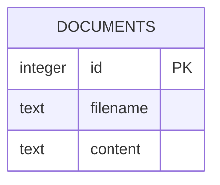
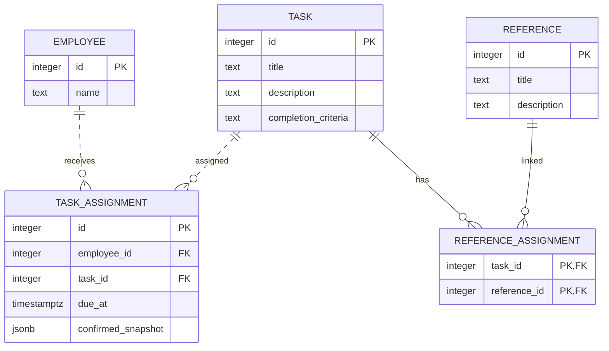

# ERD

## 문서 업로드 (구현 코드 기준)

`backend.documents`는 파일명과 UTF-8 텍스트 내용을 저장합니다. `id`는 자동 생성되며 세 컬럼 모두 필수입니다. 현재 온보딩 ERD와의 관계는 정의되지 않았습니다. Flyway 적용 및 실제 DB 동작은 별도 확인이 필요합니다.

원본: [PJT Needle ERD](https://app.notion.com/p/414e1f6a336e803d9aa2c35e6e284779?pvs=204)

## 온보딩 및 업무 ERD 초안

### 설계 메모

- `TASK_ASSIGNMENT`: `employee_id`와 `task_id`의 조합은 중복될 수 없습니다. 기한 `due_at`은 선택 사항입니다.
- `confirmed_snapshot`: 배정별로 마지막 확인 내용을 보관하는 설계 후보입니다. 미확인 상태에서는 비어 있으며, 구체적인 저장 형식은 API 설계에서 확정합니다.
- `REFERENCE_ASSIGNMENT`: `task_id`와 `reference_id`의 복합 기본 키로 동일 자료의 중복 연결을 막습니다.
- 참고 자료는 여러 업무에서 공유하며, 설명의 URL은 별도 컬럼 없이 화면에서 링크로 표시합니다. 첨부파일 보관 방식과 컬럼은 미정입니다.
- 사원 정보는 테스트용 초안이며, 로그인·권한과 단계별 업무는 이후에 설계합니다.
